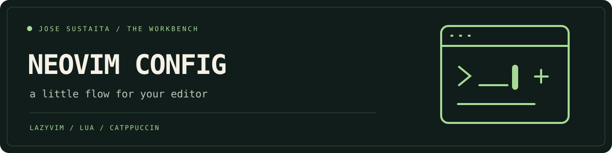

<p align="center"></p>

# Jose's Neovim workbench ✦

A Catppuccin-flavored LazyVim setup with smooth scrolling and resizing, sensible language extras, and tmux navigation. A Docker sandbox lets you try it without replacing your usual editor configuration.

## Try it in Docker

Prerequisite: **Docker with Compose v2**, an interactive terminal, and Bash/WSL.

```bash
git clone --depth 1 https://github.com/josesustaita/nvimconfig.git
cd nvimconfig
./scripts/bootstrap.sh
```

The first build installs Neovim **0.11.5**, Node 22, Go 1.25, Rust 1.90, Git, build tools, Tree-sitter CLI, ripgrep, fd, Python, and the locked plugins. Internet is needed for that setup. The container runs as the Node image's unprivileged user. It opens this checkout at `/workspace`; edits to files there are edits to the mounted host files.

```bash
./scripts/bootstrap.sh init.lua
NVIM_WORKSPACE=/absolute/path/to/project ./scripts/bootstrap.sh
NVIM_REDUCED_MOTION=1 ./scripts/bootstrap.sh
./scripts/bootstrap.sh doctor
./scripts/bootstrap.sh test
```

The image includes plugin files; named volumes preserve plugin data, editor state, and caches. The host's normal Neovim configuration is not mounted or replaced. To leave Neovim, use `:qa` (`:qa!` discards unsaved edits). `docker compose down` removes the sandbox network. Only use `docker compose down --volumes` when you intentionally want to erase the sandbox's cached editor data; project files are separate bind mounts.

Compose reads `.env` if you create it from `.env.example`. You can also set `NVIM_WORKSPACE` and `NVIM_REDUCED_MOTION` directly on the command line.

## Install alongside your own configuration

Install Neovim **0.11.5+**, Git, a C compiler, curl, ripgrep, fd, Node, and Tree-sitter CLI first. A Nerd Font is optional for richer icons. Go/Rust language tools may require their project toolchains; the Docker sandbox is an editor environment, not a replacement for every project's build image.

```bash
./scripts/install.sh
NVIM_APPNAME=jose-nvim nvim
```

The installer creates a symlink at `${XDG_CONFIG_HOME:-~/.config}/jose-nvim`, leaving the normal `nvim` configuration alone. It refuses to replace an existing destination and is safe to rerun. Choose another `NVIM_APPNAME` to install a separate profile. Keep this checkout in place while the symlink is in use.

## A few keys to know

`<leader>` is Space; use `:Lazy` to inspect plugins and `:checkhealth` for environment diagnostics.

| Key                     | Action                                               |
| ----------------------- | ---------------------------------------------------- |
| `<leader>ua`            | Toggle scrolling/resizing animations                 |
| `<leader><space>`       | Find files (LazyVim default)                         |
| `<leader>sg`            | Search project text (LazyVim default)                |
| `Ctrl+h/j/k/l`          | Navigate windows/tmux panes in normal mode           |
| `Ctrl+\`                | Return to the previous tmux pane                     |
| `Ctrl+j` in insert mode | Accept a visible Copilot suggestion, when configured |

Copilot is optional and requires your own account authorization (`:Copilot auth`). There is no API key bundled with this repo and no ChatGPT plugin configured. Regular editing works without AI access.

## Motion with an off switch

`mini.animate` adds short scrolling and resize transitions. Cursor trails and animated window opening/closing are disabled. Set `NVIM_REDUCED_MOTION=1` before launch for a still editor, or toggle with `<leader>ua`. The animated README banner respects your browser's reduced-motion setting.

## Configuration map

- `init.lua` / `lua/config/lazy.lua` — plugin bootstrap and pinned LazyVim release.
- `lazy-lock.json` — exact plugin revisions; commit intentional updates.
- `lazyvim.json` — Go, Rust, TypeScript, JSON, Tailwind, and Copilot extras.
- `lua/config/options.lua` / `keymaps.lua` — motion settings and custom keys.
- `lua/plugins/` — Catppuccin, animations, pairing, autotags, and tmux navigation.
- `scripts/check.lua` — headless plugin and reduced-motion smoke checks.

The Docker build restores the lockfile. To update deliberately, run `:Lazy sync` in a local profile, inspect the changed `lazy-lock.json`, then rebuild the image. Existing sandbox data volumes can retain older plugin versions; run `:Lazy restore` after rebuilding to align them with the bundled lockfile.

## Troubleshooting

- **No icons:** use a Nerd Font, or keep editing with the textual controls.
- **Plugin download failed:** check network access, retry the build, and inspect `:Lazy`.
- **Language server missing:** inspect `:Mason` and `:checkhealth`; some languages require additional project toolchains or provider access.
- **File permission errors in Docker:** the image runs as UID 1000. Use a writable workspace with compatible permissions; files remain owned by the container's user.
- **Terminal required:** use the interactive bootstrap for editing and `./scripts/bootstrap.sh test` in CI.

Licensed under [Apache 2.0](LICENSE).
